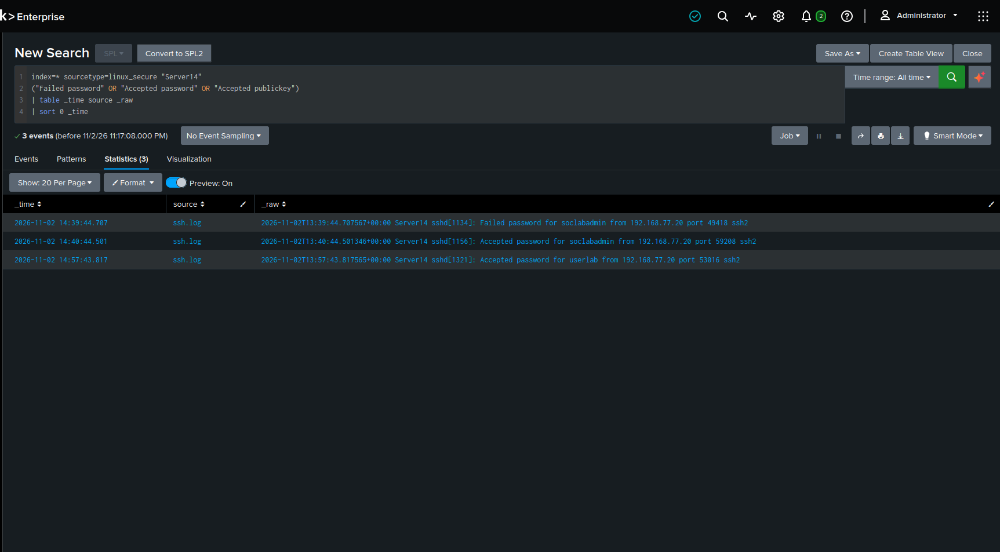
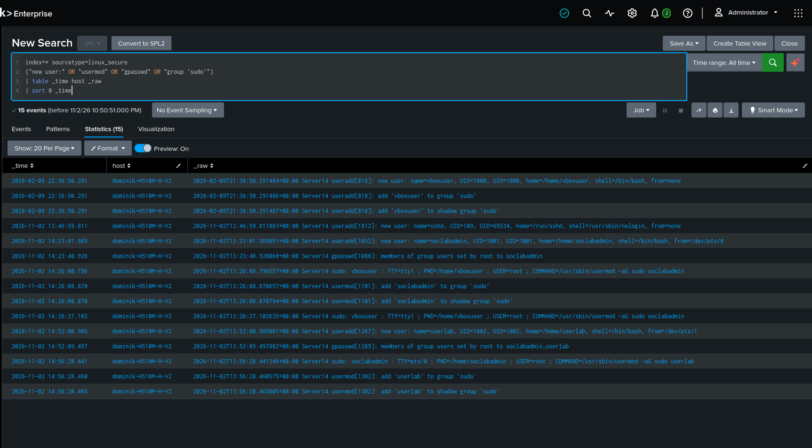
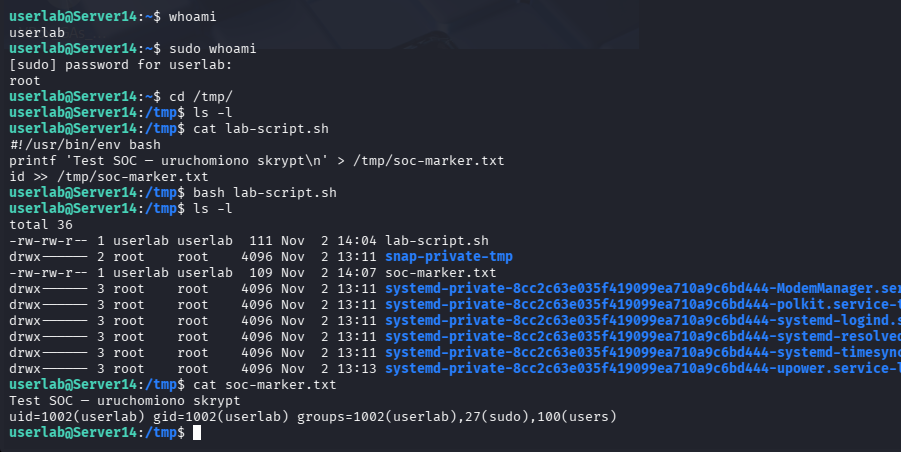
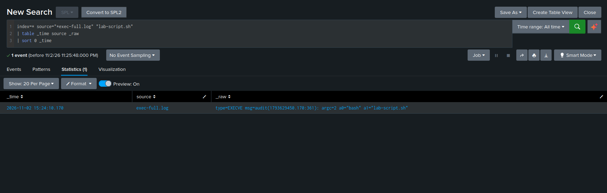

# Linux SOC Investigation

SSH, sudo i wykonanie skryptu Bash w laboratorium Ubuntu Server

Laboratorium pokazuje analizę logowań SSH, tworzenia lokalnych kont, nadawania dostępu do sudo i wykonania nieszkodliwego skryptu Bash. Zdarzenia z Ubuntu Server zostały przeanalizowane w Splunku. Potwierdzono wykonane działania; nie wykazano przełamania zabezpieczeń, brute force ani skuteczności automatycznego alertu.

## Środowisko

- Ubuntu Server `Server14`: host analizowany, `192.168.77.10`.
- Kali Linux: klient SSH, `192.168.77.20`.
- VirtualBox: NAT dla internetu oraz wspólna sieć wewnętrzna `soc-lab`.
- Splunk Enterprise na komputerze gospodarza.
- Konta laboratoryjne: `vboxuser`, `soclabadmin`, `userlab`.

## Przebieg i wyniki

Wszystkie czasy poniżej są w UTC, data 2026-11-02. Czas auth odczytano z `+00:00`, a czas audytu z epoch. Widoki Splunka mogą pokazywać inną strefę.

| Czas UTC | Działanie | Dowód |
|---|---|---|
| 13:23:01.989 | Utworzenie soclabadmin | useradd w logu uwierzytelniania |
| 13:26:08.796 | vboxuser nadaje sudo kontu soclabadmin | sudo COMMAND oraz usermod |
| 13:39:44.707 | Nieudane SSH jako soclabadmin | IP 192.168.77.20 |
| 13:40:44.501 | Udane SSH jako soclabadmin | To samo konto i IP |
| 13:52:00.905 | Utworzenie userlab | useradd w logu uwierzytelniania |
| 13:56:28.441 | soclabadmin uruchamia usermod dla userlab | Następują wpisy dodania do sudo |
| 13:57:43.817 | Udane SSH jako userlab | IP 192.168.77.20 |
| 14:24:10.170 | bash lab-script.sh | Audit ID 361; czas z epoch audytu |

Konto soclabadmin i jego sudo przygotowano przed logowaniem SSH. Następnie w sesji utworzono userlab, nadano mu sudo i zalogowano się na to konto. Skrypt uruchomiono jako userlab, bez sudo.

### Nieudane SSH, sukces soclabadmin i sukces userlab



### Tworzenie kont i nadanie dostępu do sudo



### Skrypt i znacznik z tożsamością userlab



### Rekord EXECVE z bash i lab-script.sh



## Odtworzenie laboratorium

Polecenia dotyczą wyłącznie własnej VM. Audit należy uruchomić przed symulacją.

```bash
sudo apt update
sudo apt install openssh-server auditd
sudo systemctl enable --now ssh auditd
```

Skopiuj `audit/70-soclab.rules` do `/etc/audit/rules.d/`, następnie:

```bash
sudo augenrules --load
sudo auditctl -l
```

Z Kali zaloguj się na konto administratora:

```bash
ssh soclabadmin@192.168.77.10
```

W sesji na Ubuntu utwórz konto i nadaj grupę:

```bash
sudo adduser userlab
sudo usermod -aG sudo userlab
exit
```

Z Kali otwórz nową sesję:

```bash
ssh userlab@192.168.77.10
whoami
sudo whoami
```

Zapisz zawartość `scripts/lab-script.sh` na Ubuntu jako `/tmp/lab-script.sh`, a następnie:

```bash
bash /tmp/lab-script.sh
cat /tmp/soc-marker.txt
```

Uruchomienie przez bash nie wymaga bitu wykonywania. Wynik `sudo whoami` dotyczy tylko tego polecenia i nie zmienia całej sesji na root.

## Zbieranie i import danych

```bash
mkdir -p ~/soc-export
chmod 700 ~/soc-export
sudo cat /var/log/auth.log > ~/soc-export/auth.log
sudo ausearch -k soc_exec --raw > ~/soc-export/exec-full.log
```

Pełny bieżący audyt można zachować poleceniem `sudo cat /var/log/audit/audit.log > ~/soc-export/audit.log`. Dla plików po rotacji trzeba uwzględnić odpowiednie archiwa. Nie publikuj bez przeglądu pełnych logów z rzeczywistego systemu.

Pliki przeniesiono przez SCP. Import do Splunka wykonano osobno: auth lub ssh jako `linux_secure`, audyt jako `linux_audit`. Należy zweryfikować czas i granice zdarzeń w podglądzie. Nazwa sourcetype sama nie gwarantuje poprawnego parsowania.

## Zapytania SPL

Ustaw All time lub przedział laboratorium. Zastąp `index=*` konkretnym indeksem, gdy znasz jego nazwę. Zapytania 01–04 odpowiadają analizie udokumentowanej screenami; 05 jest pomocniczą korelacją do dalszej weryfikacji.

### 01-ssh.spl

```spl
index=* sourcetype=linux_secure "Server14"
("Failed password" OR "Accepted password" OR "Accepted publickey")
| rex field=_raw "(?<result>Failed|Accepted) (?:password|publickey) for (?:invalid user )?(?<account>\S+) from (?<src_ip>\S+)"
| table _time account src_ip result source _raw
| sort 0 _time
```

### 02-accounts.spl

```spl
index=* sourcetype=linux_secure "Server14"
("new user:" OR "usermod" OR "gpasswd" OR "group 'sudo'")
| table _time source _raw
| sort 0 _time
```

### 03-sudo.spl

```spl
index=* sourcetype=linux_secure "Server14" "sudo" "COMMAND="
| table _time source _raw
| sort 0 _time
```

### 04-bash.spl

```spl
index=* source="*exec-full.log" "type=EXECVE" "lab-script.sh"
| table _time source _raw
| sort 0 _time
```

### 05-audit-correlation.spl

```spl
index=* source="*exec-full.log" "type="
| rex field=_raw "msg=audit\((?<audit_id>[^)]+)\)"
| stats min(_time) as _time values(_raw) as records by host source audit_id
| where mvfind(records, "lab-script[.]sh") >= 0
| sort 0 _time
```

## Interpretacja audytu

`EXECVE` pokazuje program i argumenty. Powiązany `SYSCALL` zawiera uid, euid, auid, pid i ppid. `auid` identyfikuje pierwotnie zalogowanego użytkownika, a euid uprawnienia procesu. Rekordy jednego zdarzenia łączy identyfikator `msg=audit(...:361)`. Nie należy utożsamiać kilku rekordów tego samego zdarzenia z kilkoma uruchomieniami.

## MITRE ATT&CK

Mapowania opisują zachowania symulowane w laboratorium, nie rozstrzygają o złośliwości.

| Technika | Nazwa | Interpretacja |
|---|---|---|
| T1136.001 | Local Account | Utworzenie lokalnego userlab; symulacja zachowania. |
| T1098.007 | Additional Local or Domain Groups | Dodanie userlab do sudo; najdokładniejsze mapowanie zmiany grupy. |
| T1059.004 | Unix Shell | Wykonanie skryptu przez Bash. |
| T1548.003 | Sudo and Sudo Caching | Kontekst analizy sudo; zwykłe sudo whoami nie dowodzi nadużycia. |
| T1110 | Brute Force | Niepotwierdzone w tej próbie; pojedynczy błąd hasła nie wystarcza. |

## Ograniczenia i możliwe false positives

- Zarejestrowano jedną nieudaną próbę SSH przed sukcesem. Nie jest to dowód brute force; seria prób i przypadek kontrolny pozostają rozszerzeniem projektu.
- Polecenia administracyjne wykonano z kont mających wcześniej dostęp do sudo. Nie testowano podatności ani obejścia autoryzacji.
- Skrypt zapisuje wyłącznie znacznik i wynik id. Nie pobierano go przez HTTP; nie należy opisywać testu jako download and execute.
- Potwierdzono wyniki wyszukiwania SPL. Nie skonfigurowano i nie zweryfikowano alertu, harmonogramu ani progów detekcji.
- Wstępny audit.log był eksportem interpretowanym z ostatnich 10 minut i pomijał skrypt. Dowód wykonania odzyskano przez eksport exec-full.log w formacie raw.
- Pole host w imporcie wskazywało komputer ze Splunkiem, mimo że treść auth zawiera Server14. Zapytania ograniczono tekstem Server14; przy kolejnym imporcie należy ustawić poprawny host.
- Starsze dane Webserver1, Webserver2 i Webserver3 wykluczono z wniosków. auth.log i ssh.log mogą się pokrywać; należy analizować tylko jedną kopię tych samych zdarzeń.
- Reguła b64 obejmuje wykonania 64-bitowe i nie zapisuje wszystkich instrukcji wbudowanych powłoki. Wbudowany printf nie musi mieć osobnego rekordu EXECVE.

Legalna administracja może tworzyć konta i dodawać je do sudo; literówka może powodować błędne SSH, a skrypty w /tmp bywają częścią instalatorów. Wymagany jest kontekst użytkownika, IP, czasu, zatwierdzonych zmian i treści polecenia.

## Kolejne kroki

- Dodać test kilku błędnych logowań zakończonych sukcesem oraz czysty przypadek kontrolny.
- Zbudować korelację tego samego hosta, konta i IP w ustalonym oknie czasowym.
- Sprawdzić próg, false positives i zachowanie alertu, zanim opisze się go jako zweryfikowaną detekcję.
- Poprawić metadane hosta i wdrożyć ciągłe zbieranie logów zamiast ręcznych eksportów.

## Zawartość repozytorium

`queries/` — SPL; `audit/` — reguły; `scripts/` — nieszkodliwy skrypt; `screenshots/` — dowody; `docs/` — raport Word. Pełne surowe logi nie są częścią paczki. Screeny zachowują nazwy laboratoryjne i prywatne adresy; metadane hosta widoczne w dowodach nie są poprawione wstecz.

## Źródła

- [Linux Audit rules](https://man7.org/linux/man-pages/man7/audit.rules.7.html)
- [Linux ausearch](https://man7.org/linux/man-pages/man8/ausearch.8.html)
- [MITRE Local Account](https://attack.mitre.org/techniques/T1136/001/)
- [MITRE Additional Groups](https://attack.mitre.org/techniques/T1098/007/)
- [MITRE Unix Shell](https://attack.mitre.org/techniques/T1059/004/)
- [MITRE Sudo](https://attack.mitre.org/techniques/T1548/003/)
